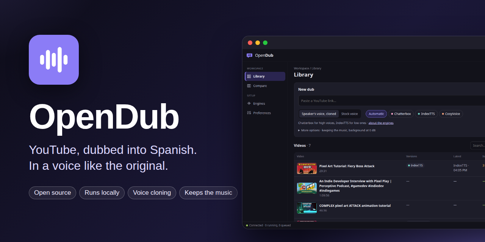

<p align="center">
  
</p>

# OpenDub

A personal tool that dubs YouTube videos into Spanish with a synthetic voice,
kept in sync with the original.

```
URL → download (yt-dlp) → transcription (subtitles or faster-whisper)
    → separation (HTDemucs) → translation (Claude)
    → voice (Chatterbox, IndexTTS, CosyVoice or edge-tts) → mix (numpy + ffmpeg) → MP4
```

How each piece works: [docs/architecture.md](docs/architecture.md).

## Installation

macOS (Apple Silicon):

```bash
brew install ffmpeg uv
uv sync
```

Ubuntu (optionally with an NVIDIA GPU):

```bash
sudo apt install ffmpeg
curl -LsSf https://astral.sh/uv/install.sh | sh
uv sync
```

Voice/music separation (`--separate`) needs an optional extra: it installs
demucs-mlx on Apple Silicon, and demucs with PyTorch (CUDA 12.8 wheels, which RTX
50-series GPUs require) on Linux:

```bash
uv sync --extra separate
```

On Linux, whisper and the separator use the NVIDIA GPU automatically when one is
available; on a Mac, whisper runs on the CPU and the separator on the Apple GPU.

Voice cloning (`--tts clone`) needs another extra, with Chatterbox Multilingual V3
(installed from a pinned GitHub commit, since it isn't on PyPI yet). It also needs
the separation, so install both:

```bash
uv sync --extra separate --extra clone
```

The other two cloning engines, IndexTTS-2.5 (`--engine indextts`) and
CosyVoice 3 (`--engine cosyvoice`), pin their own Python and PyTorch, so each
lives in a separate venv and runs as a separate process. `setup-engine` clones a
pinned commit of its repo, creates that venv and downloads the weights into
`~/.local/share/opendub/<engine>` (or `$OPENDUB_INDEXTTS_DIR`,
`$OPENDUB_COSYVOICE_DIR`):

```bash
uv run opendub setup-engine indextts   # ~5 GB, plus ~5 GB of auxiliary models on the first run
uv run opendub setup-engine cosyvoice  # ~9 GB
```

IndexTTS's venv comes from its repo's own lockfile, plus flash-attn for its
acceleration engine (1.3× faster, same quality; without it if that fails).
CosyVoice's comes from [engines/cosyvoice/pyproject.toml](engines/cosyvoice/pyproject.toml),
whose versions were checked on an RTX 5080 (its repo pins a PyTorch without RTX
50-series support). If an engine isn't installed, choosing it says which
command installs it. (`setup-indextts` still works too.)

There are two ways to translate:

- **Claude subscription (default, `--backend cli`)**: uses your Claude Code
  session. Install it and run `claude` once to sign in:
  ```bash
  curl -fsSL https://claude.ai/install.sh | bash
  ```
- **API (`--backend api`)**: copy `.env.example` to `.env` and fill in
  `ANTHROPIC_API_KEY`. The same translation, billed per token instead of by the
  subscription: the way to go on if the subscription can't be used for this. A
  local backend (Ollama) is planned, so a dub needn't depend on either.

## Usage

```bash
uv run opendub dub "https://www.youtube.com/watch?v=rwF-X5STYks" -o dubbed.mp4
```

Common `dub` options:

| Option | Default | What it does |
|---|---|---|
| `--voice` | `es-ES-AlvaroNeural` | edge-tts voice (`es-ES-ElviraNeural`, `es-MX-JorgeNeural`…) |
| `--tts` | `edge` | `edge`: the `--voice` voice · `clone`: the original speaker's voice, cloned from the separated vocals |
| `--engine` | `chatterbox` | Cloning engine for `--tts clone`: `chatterbox`, `indextts`, `cosyvoice` or `auto` (by the reference's pitch, see below) |
| `--min-factor` | `0.7` | `indextts`, `cosyvoice`: lowest duration factor before shortening a sentence that doesn't fit |
| `--keep-translation` | off | Reuses the existing translation even if it was made for another engine: only TTS and the mix are redone |
| `--style` | none | Extra `style.json` (register, variant, glossary, notes; see below) over `work/style.json` and the video's own |
| `--clone-ref` | none | Fixed Spanish recording to clone from when a cloned clip fails the quality check |
| `--bg-volume` | `-15` | Volume of the original audio, in dB |
| `--mute-original` | off | Drops the original audio |
| `--separate` | off | Mixes over the separated background (music and effects, without the original voice) instead of the turned-down original |
| `--music-volume` | `0` | Volume of the separated background, in dB |
| `--separator` | `auto` | `mlx` (Apple Silicon) or `torch` (CUDA or CPU); `auto` picks by platform |
| `--subs` | `manual` | `manual`: manual subtitles or whisper · `auto`: auto-generated ones too · `none`: always whisper |
| `--source-lang` | YouTube's | Original language (whisper detects it when unknown) |
| `--whisper-model` | `small` | faster-whisper model (`medium`, `large-v3`… are slower) |
| `--backend` / `--model` | `cli` / `claude-sonnet-5-5` | How and with which model to translate |
| `--rate` | `-10%` | Native edge-tts speaking rate (more negative = slower, without stretching the audio) |
| `--chars-per-second` | calibrated | Speaking rate used to cap each translation's length; measured with the chosen voice by default |
| `--shorten` / `--no-shorten` | on | If a sentence doesn't fit even at `--max-tempo`, ask Claude for a shorter version and re-synthesize it |
| `--max-tempo` / `--min-tempo` | `1.25` / `0.9` | atempo range: a clip that ends well before its sentence did in the original is slowed down, without pushing the next one (`--min-tempo 1` never slows down) |
| `--force` | off | Redoes every phase |

Each phase can also run on its own: `download`, `transcribe`, `translate`, `tts`,
`separate` and `mix` (all accept the URL or the video id). `separate` only needs
`download`, so it can run at any point before `mix --separate`. Run
`uv run opendub <phase> --help` to see its options.

### Translation style and glossary

A `style.json` sets how a translation reads. `work/style.json` applies to every
video, and `work/<video id>/style.json` to one video, winning over the global one.
Both are optional, and the web page edits them too:

```json
{
  "register": "tu",
  "variant": "es-ES",
  "terms": [
    {"source": "itch store", "target": "tienda de itch.io"},
    {"source": "VFX", "target": ""}
  ],
  "notes": "Pixel art channel: 'frame' stays as 'frame'."
}
```

- `register`: `tu`, `usted` or `auto` (keeps the original's).
- `variant`: `es-ES`, `latam` or `auto` (follows `--voice`). A variant also
  switches an edge-tts voice of the other variant to `es-ES-AlvaroNeural` or
  `es-MX-JorgeNeural`.
- `terms`: how each term must be rendered; an empty `target` keeps it as in the
  original. Whole words, any case.
- `notes`: free instructions for this channel or video.

Each block of 30 sentences only gets the terms it says, and is cached by its own
inputs. Adding a term only re-translates the blocks that say it, and a term the
video never says changes nothing. Shortened sentences keep the glossary too. A
sentence whose spoken text doesn't use a term its original says is listed as a
`glossary` issue on the web page, except hand edits.

### Several voices

```bash
uv run opendub setup-engine nemotron        # once: NVIDIA Nemotron 3 Diarization in its own venv
uv run opendub dub <url> --tts clone --separate --multi-speaker
```

`--multi-speaker` (the web's *Several voices*) tells who speaks each sentence and
gives each person their own voice: the vocals are diarized (speakers with under
30 s of speech are ignored), sentences are cut where the speaker changes, each
speaker is cloned from their own turns (one with under 6 s of clean speech gets
the stock voice of their gender), and each sentence is translated to fit its
speaker's pace, with their gender for the agreement. On the web page, each
speaker can be named, heard and merged into another, and any sentence given to
someone else: a retouch then speaks it with the right voice. On the web page it is
ticked by default once Nemotron is installed (a single-voice video keeps one
voice); on the CLI it is asked for with `--multi-speaker`, also by the `translate`
and `tts` phases run on their own.

### Exporting

```bash
uv run opendub export KS837a-TFRc -f mkv            # the latest dub; --version for a kept one
```

| Format | What you get |
|---|---|
| `mkv` | The video with the dubbed audio (default track), the original audio and both subtitles as selectable tracks |
| `m4a` | The dubbed audio alone |
| `srt` | Spanish subtitles of what the voice says, timed where the mix placed each clip, in screens of up to two lines |
| `srt-orig` | The original sentences at their original timestamps |

Nothing is re-encoded: an MKV of a 19-minute video takes under a second. Each
export is kept next to its version (`outputs/<version>.mkv`…), is deleted with it,
and is offered by the web page's **Download** menu too.

### Retouching a few sentences

```bash
uv run opendub retouch KS837a-TFRc --take 12 --take 40 --separate
```

`retouch` speaks again, with the dub's own engine, the sentences whose
translation changed since the latest dub (hand edits in `translation.json` or
from the web) and each `--take`, then mixes a new version. Each goes through
the same fitting and quality check as a full dub, judged against the whole
video. The chosen takes are remembered in `takes.json`, so a later full dub
keeps them, and the TTS phase stays cached for the new translation. Hand-edited
sentences are never rewritten shorter, in a retouch or a full dub: what doesn't
fit is compressed as far as the engine allows and reported.

## Web frontend

A local dashboard to dub without the command line, in English or Spanish, dark
or light, with a choice of accent color (Preferences):

- **Library**: paste a YouTube link, pick the voice (cloned or stock), the
  engine (*Automatic* by default) and whether to keep the music; follow the
  running dub phase by phase, and find every video with its versions, the
  latest one, its issues and its status.
- **Video**: the player, a timeline with each issue where it happens (click to
  jump), and every dub kept: each one plays and shows its numbers
  (voice time, sped up, shortened, below the floor, redone, edge-tts) and its
  own issues, downloads as MP4, MKV (both audio tracks and subtitles), audio or
  SRT, and older ones can be deleted (the latest stays). The translation,
  segment by segment, shows each issue of the version you watch next to its
  sentence, filters to those or to hand edits, and saves edits. **Regenerate**
  speaks again only the edited sentences and those marked for **another take**
  (the same text, the next seed of the cloned voice), then mixes a new version:
  ~30–40 s on a 19-minute video instead of a whole TTS phase. **Re-dub…** picks the engine (with what it did last time on that video)
  and keeps the translation by default, so only the voice and the mix run.
- **Compare**: two versions side by side, playing in sync, heard one at a
  time (A/B keys), with how each one fitted and the segments where they differ.
- **Engines**: each engine's license, where it runs, its benchmark figures and
  whether it is installed (with the command that installs it).

Every dub made is kept (`outputs/<date>-<engine>.mp4`, with its `tts.json` and
`overflow.log`), whatever the engine and however many times the video is dubbed
again; long videos take ~100 MB per version.

```bash
uv sync --extra web          # plus --extra separate --extra clone for cloned voices
uv run opendub web           # http://127.0.0.1:8000, opens the browser
```

It only listens on 127.0.0.1 and runs one job at a time (the others wait in
order); it uses the same `work/` folder and cache as the CLI.

To use it from another device on your network (a tablet, the TV's browser):

```bash
uv run opendub web --lan     # prints a link with an access token for each address
```

Open that link once on each device: the token is kept in a cookie and taken out of
the address bar. Without it, every request gets a 401 and the page only says where
to find the link. The token changes on every start, so old links stop working;
anyone with a current link can use OpenDub on this computer, so share it only with
your own devices. There is no mode open to the network without the token.

### Starting the web page on its own

Optional, on Linux: [docs/systemd/opendub-web.service](docs/systemd/opendub-web.service)
is a systemd user service that starts `opendub web` with your session and brings it
back if it crashes. Copy it, set `WorkingDirectory` to your checkout, and enable it:

```bash
cp docs/systemd/opendub-web.service ~/.config/systemd/user/
systemctl --user daemon-reload
systemctl --user enable --now opendub-web
```

Its log is in `journalctl --user -u opendub-web` (with `--lan`, the links with the
token are there too). `systemctl --user stop opendub-web` stops it like a Ctrl+C: a
dub that is running is cut short and goes on from its cache when dubbed again. To
keep it running when you log out: `loginctl enable-linger`.

The page is a React 19 + TypeScript app in [frontend/](frontend/), built with
Vite into `src/opendub/web/static/`, which is committed: running it needs no
Node, only changing it does (Node 22+):

```bash
cd frontend && npm install
npm run dev      # http://localhost:5173, against a running `opendub web`
npm run build    # rebuild src/opendub/web/static/
```

## Cache and working folder

Everything is stored in `work/<video id>/`. A phase is skipped if it already ran
with the same parameters, and changing a parameter only redoes that phase and the
ones that depend on it (for example, changing `--voice` repeats TTS and mixing,
but neither the translation nor the separation).

| File | Contents |
|---|---|
| `video.mp4`, `audio.wav`, `subs.*` | Download |
| `segments.json` | Original sentences with timestamps |
| `translation.json` | Translation (you can edit it by hand and rerun `tts`) |
| `takes.json` | The seed of each sentence given another take (retouch) |
| `style.json`, `translation.style.json` | The video's own translation style, and the one its translation was made with |
| `translate_blocks/` | Each translated block, cached by its own inputs |
| `tts/`, `tts.json` | One clip per sentence, with its tempo, duration and spoken text (shortened if needed) |
| `overflow.log` | Sentences that didn't fit their slot, clips with abnormal duration and delayed clips |
| `stems/vocals.wav`, `stems/background.wav` | Separated original voice and background |
| `clone_ref.wav` | 10–15 s of the original speaker used as the cloning reference (`--tts clone`) |
| `dub.wav`, `output.mp4` | Dubbed track and final video |
| `thumbnail.jpg`, `job.json` | Web frontend: thumbnail, and the last job's options and outcome |

Each voice's calibrated speaking rate is stored in `work/voice_rates.json`;
delete it to measure again.

## Voice cloning

With `--tts clone`, `dub` separates the audio right after transcribing it,
picks the 10–15 s stretch of the original speaker with the fewest pauses as the
reference and measures the cloned voice's speaking rate before translating. The
log prints the reference's mean pitch (F0) next to the engine, and `tts.json`
keeps both.
Every cloned clip is transcribed back with whisper (`--whisper-model`); one
whose text doesn't match, or whose duration is abnormal, goes down a fallback
chain that keeps the same voice as long as possible:

1. Regenerate with another seed.
2. Regenerate with a shorter version of the sentence, written by Claude.
3. Clone from the fixed reference (`--clone-ref`), if one was given.
4. edge-tts (`--voice`) as a last resort, recorded in `overflow.log`.

`tts.json` records which of these produced each clip. Chatterbox adds Resemble
AI's inaudible Perth watermark to everything it generates. On a GPU with 12 GB or
more, Chatterbox speaks with two processes side by side (about 1.25× faster on a
long video); `OPENDUB_CHATTERBOX_WORKERS=1` keeps it to one.

### Choosing the engine

Chatterbox is the default; IndexTTS and CosyVoice are chosen per video with
`--engine`. Chatterbox and IndexTTS split the benchmark (details in
[docs/v2-plan.md](docs/v2-plan.md)): IndexTTS fits its slots far better (41/42
clips without atempo, against 30/42), and by ear it was preferred for the male
voice but not for the female one, where Chatterbox sounded steadier (IndexTTS
sometimes sounds as if trembling). So: `--engine indextts` for low voices, the
default Chatterbox for high ones.

CosyVoice 3, benchmarked later on the same material, speaks fastest
(~16 chars/s), so nearly every clip fits as is (42/42 in the benchmark; none of
the 41 clips of the real dubs of both videos needed atempo), with a native accent and the least tremor on the male
voice. It clones cross-lingually (reference audio, no transcript) and once in a
while garbles a sentence; the quality check catches it (in the female test
video, one sentence ended on edge-tts after every retry).

`--engine auto` applies the Chatterbox/IndexTTS rule by itself: IndexTTS when the reference's mean
F0 is below 165 Hz, Chatterbox otherwise (or when the pitch can't be measured).
It comes from two voices, one of each, so it is opt-in and a low female or high
male voice may land on the wrong side; the log line and `tts.json` record the
engine, how it was chosen and the F0, so that after 8–10 videos the rule can be
checked before it becomes the default.

The engines fit clips to their slot differently. Chatterbox has no length
control, so clips that don't fit are sped up with atempo (up to `--max-tempo`)
and, if that's not enough, shortened by Claude. IndexTTS (`duration_factor`) and
CosyVoice (`speed`, which stretches the spectrogram before the vocoder) take a
duration factor, and the order is:

1. Speak each clip with the factor its calibrated speaking rate predicts for
   the slot (IndexTTS's rate is measured at factor 0.85, so translations aren't
   cut more than needed), never below `--min-factor` (0.7), and correct it once
   with the measured duration.
2. If it still doesn't fit, ask Claude for a shorter sentence.
3. Only if the shortened sentence doesn't fit either, compress below
   `--min-factor`, down to 0.5, noted in `overflow.log`; atempo covers whatever
   is left.

`tts.json` records the engine and the factor of each clip. The workers log to
`work/indextts.log` and `work/cosyvoice.log`.

Each engine keeps its own license: see [Licenses](#licenses).

## Licenses

OpenDub's own code, this repository, is under the [MIT license](LICENSE). It
covers OpenDub's code only. The voice engines and models run in their own venvs,
are downloaded from their authors when installed (`uv sync --extra …`,
`setup-engine`, Hugging Face), are not redistributed here, and each keeps its own
license:

| Component | License | Notes |
|---|---|---|
| Chatterbox Multilingual V3 (Resemble AI) | MIT | Its output carries Resemble AI's inaudible Perth watermark |
| IndexTTS-2.5 (bilibili) | bilibili Model Use License Agreement | Allows this personal use; separate license above 100 M monthly users; outputs may not train other models; revocable ([details](docs/v2-plan.md)) |
| CosyVoice 3 (Alibaba FunAudioLLM) | Apache 2.0 | Code and weights |
| Nemotron 3 Diarization (NVIDIA) | OpenMDW 1.1 | Several voices |
| HTDemucs (demucs) | MIT | Separation |
| faster-whisper and the Whisper models | MIT | Transcription, quality check |
| yt-dlp | Unlicense | Download |

Two services are used online: edge-tts talks to Microsoft's read-aloud voices (not
an official API, under Microsoft's terms), and the translation sends the
transcript to Anthropic (Claude) under your subscription or API terms. OpenDub is
a personal tool: it is not packaged or supported for distribution.

## Responsible use

OpenDub is a tool for **personal use**: watching in Spanish videos you'd otherwise
watch in English. Don't publish dubs made with cloned voices of other people.

- Clone a voice only with the consent of the person it belongs to, and don't
  present a cloned voice as that person speaking.
- Dub only what you may adapt (your own videos, content whose license allows it,
  personal study): a dub is a derivative work of its source, and the rights of
  the original video stay with its owners.

## Known limitations

- If a sentence still doesn't fit at 1.25× after two shortening rounds, the next
  clip is delayed instead of overlapping; the drift is recovered at the next pause.
- On a Mac, faster-whisper runs on the CPU (CTranslate2 doesn't use Metal):
  `small` transcribes about 2 minutes of audio in ~20 s.
- edge-tts relies on an unofficial Microsoft service and could stop working.
- Voice cloning follows a single speaker (the one in the reference); videos
  with several voices are all dubbed with that one.
- On Linux, whisper uses the GPU only when cuBLAS and cuDNN can be loaded: they
  come with `uv sync --extra separate` (PyTorch's CUDA wheels) or a system CUDA
  install; otherwise it falls back to the CPU with a warning. Tested on an RTX
  5080: `large-v3` transcribes 2.5 minutes of audio in ~10 s.

## Benchmarks

The scripts behind the engine choices (generation, CER, accent, voice
similarity, F0, jitter and 3–9 Hz tremor) are in [docs/bench/](docs/bench/);
`uv run docs/bench/run.py <name>` scores a new model against all the others.

## Tests

```bash
uv run pytest
```

They need ffmpeg and the `web` extra, but no GPU and no voice engine: every
test that would reach one replaces it. GitHub Actions runs them on each push
and pull request (`.github/workflows/ci.yml`), and also checks the frontend:
its types, and that the committed build in `src/opendub/web/static` matches
what `npm run build` makes from `frontend/` (rebuild and commit it after
changing the frontend).
