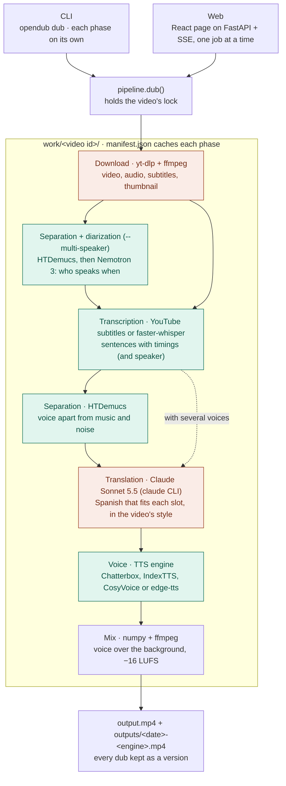
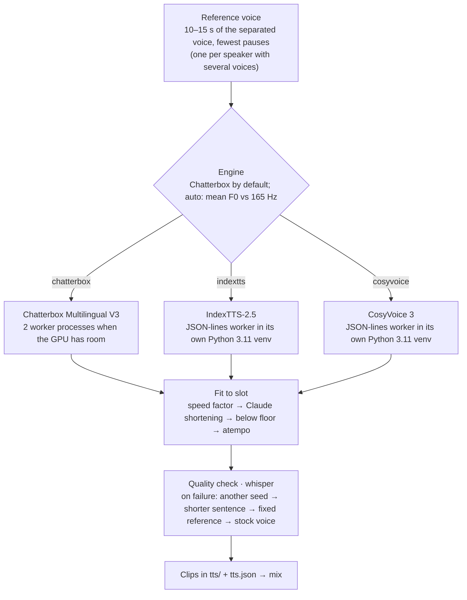
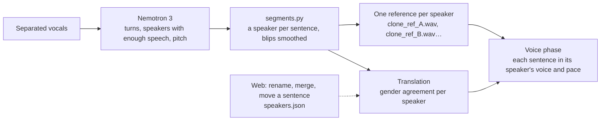

# Architecture

How the pieces fit together to dub a video. Each box links to the module that
implements it under `src/opendub/`.

## Pipeline



Green runs on the local GPU; orange talks to an external service (YouTube,
Claude). Separation runs before translation whenever the voice is cloned or the
music is kept, since the cloned voice's pace (measured from the separated vocals)
caps the translation's length; with several voices it runs first, with the
diarization, since the transcription splits sentences where the speaker changes.

| Piece | Module | Role |
|---|---|---|
| CLI | `cli.py` | `dub`, each phase on its own (`download` … `mix`), `retouch`, `export`, `web`, `setup-engine`. A phase command holds its video's lock until it ends. |
| Web | `web/app.py`, `web/jobs.py`, `web/videos.py`, `frontend/` | Job queue (one at a time, cancellable), replayable SSE progress, versions with their own numbers and issues, translation editor, retouch, speakers, style, storage, Ctrl+C guard. Errors carry a code the page translates. Local only, or `--lan` with an access token. The page is a React 19 + TypeScript app built into `web/static/`. |
| Pipeline | `pipeline.py` | Runs the phases in order under the video's lock (`dub`, `retouch`); `release_models()` frees GPU memory after each web job. |
| Child processes | `media.py`, `engines.py` | The single place ffmpeg, yt-dlp's children, the engine workers and the `claude` CLI are started from, so the web server can keep them out of a stray Ctrl+C and stop them on exit. `engines.py` is the shared JSON-lines client of the engines that run in their own process, with a per-clip timeout. |
| Download | `download.py` | yt-dlp for the video, audio, subtitles and thumbnail; clear messages for YouTube's bot check and network errors. |
| Diarization | `diarize.py`, `workers/diarize_worker.py` | Nemotron 3 Diarization in its own venv (`engines/nemotron`): speaker turns and each speaker's pitch. |
| Transcription | `transcribe.py`, `segments.py` | Uses YouTube's subtitles when available, faster-whisper otherwise; regroups pieces into sentences with timings, and gives each one a speaker. |
| Separation | `separate.py` | HTDemucs splits the original voice from the background, which is kept for the mix. |
| Translation | `translate.py`, `style.py`, `speakers.py` | Claude translates in blocks, each sentence within a character budget set by its voice's pace model, in the video's register, variant and glossary; keeps hand edits and speaker corrections made in the web. Each block is cached by its own inputs. |
| Voice | `tts.py`, `voices.py`, `repair.py`, `retouch.py`, `clone.py`, `indextts.py`, `cosyvoice.py`, `reference.py`, `spoken.py` | See below: `voices.py` gives each sentence its voice (one, or each speaker's), `repair.py` fits and repairs after the first pass, `retouch.py` speaks again only what changed. |
| Mix | `mix.py` | Places each clip at its timestamp over the background, normalizes the loudness in two passes, writes `output.mp4` and keeps it as a version in `outputs/`. |
| Exports | `export.py` | A version as subtitles (dubbed or original), an MKV with both audio tracks, or its audio, made on request and kept. |
| Storage | `storage.py` | What each video takes on disk, and deleting what can be made again (source, stems, raw clips, clips, exports). |

Every phase stores its result in `work/<video id>/` under a hash of its
parameters in `manifest.json`: changing a setting reruns only from the phase it
affects. State files are written atomically (`workdir.write_text_atomic`), so an
interrupted run never leaves half a JSON behind.

## Voice phase

The slowest phase (most of a dub's time).



- **Reference** (`reference.py`): the cleanest 10–15 s stretch of the separated
  voice; its mean F0 picks the engine under `--engine auto` and the stock voice's
  gender for the fallback.
- **Pace model** (`tts.py`): seconds = overhead + characters / characters per
  second, calibrated per voice and cached. It sets the translation's character
  budget and predicts each clip's speed factor.
- **Fit to slot**: IndexTTS and CosyVoice take a speed factor between 0.7 and 1.0
  (one measured correction); if the clip still overflows, Claude shortens the
  sentence; then the factor may go down to 0.5 (logged in `overflow.log`), and
  `atempo` covers what is left.
- **Quality check** (`clone.py`): whisper transcribes each clip, with figures
  spelled out in words (`spoken.py`), and compares it with the text; failing
  clips walk the fallback chain, ending with the stock voice (edge-tts) of the
  speaker's gender.
- **A hung engine** (`engines.speak`): each clip has a timeout that grows with its
  text; past it the worker is killed and started again once, then the clip is left
  as a short beep the quality check flags, and the dub goes on.
- **Variants**: `chatterbox-es`, the es-ES finetune, is a CLI-only engine name for
  comparisons (`docs/bench/listening`); its versions are named after it.

## Several voices

`--multi-speaker` (experimental) gives each speaker their own cloned voice.



Corrections made on the page (`speakers.py`) are kept in `speakers.json`, so a
translation made again keeps them; a corrected sentence counts as pending and the
next retouch speaks it with the right voice.

## After a dub: edit, retouch, style

```mermaid
flowchart LR
    edit["Edit a sentence<br/>translation_edits.json"] --> pending
    take["Ask for another take"] --> pending
    spk["Correct its speaker"] --> pending
    pending["Pending sentences<br/>tts.pending_edits"] --> retouch["pipeline.retouch<br/>speaks only those, from the cached clips"]
    retouch --> mix["Mix → a new version"]
    style["Style: register, variant, glossary, notes<br/>work/style.json + work/&lt;id&gt;/style.json"] --> retr["Translation again<br/>only the blocks whose inputs changed"]
```

- **Retouch** (`tts.retouch`): speaks again only the edited sentences and the new
  takes of the latest dub and mixes a new version, in seconds instead of a whole
  voice phase. It needs the latest dub's clips; if they were deleted to save
  space, the page says so and the next dub speaks the voice again.
- **Style** (`style.py`): a global style and one per video (which wins). Each
  translation block only gets the glossary terms its text contains, so adding a
  term re-translates only the blocks that say it.

## Versions, exports and disk

Every dub made is kept as `outputs/<date>-<engine>.mp4` with its `tts.json` and
`overflow.log` (a hard link while it is also `output.mp4`); versions are never
deleted automatically. `export.py` makes subtitles, an MKV with both audio tracks
and subtitles, or the dubbed audio of any version, on request. `storage.py` lists
what each video takes and deletes, only when asked from the page, what can be
made again; the phases that need a deleted group make it again (download the
source, separate the stems, speak the clips).

## One video, one process

- **Lock** (`WorkDir.lock`): a dub, a retouch or a phase command holds an
  exclusive lock on `work/<id>/.lock`; a second process is refused with who holds
  it, and the web answers 409 to edits while it is held.
- **Cancel** (`log.request_cancel`): the web's Cancel stops a running job at the
  next progress step or Claude call; what was done is cached, so dubbing it again
  goes on from there. A queued job that is cancelled never starts.
