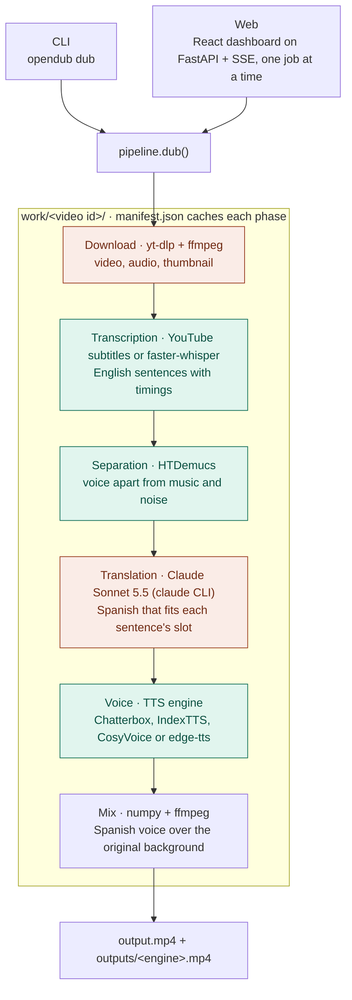
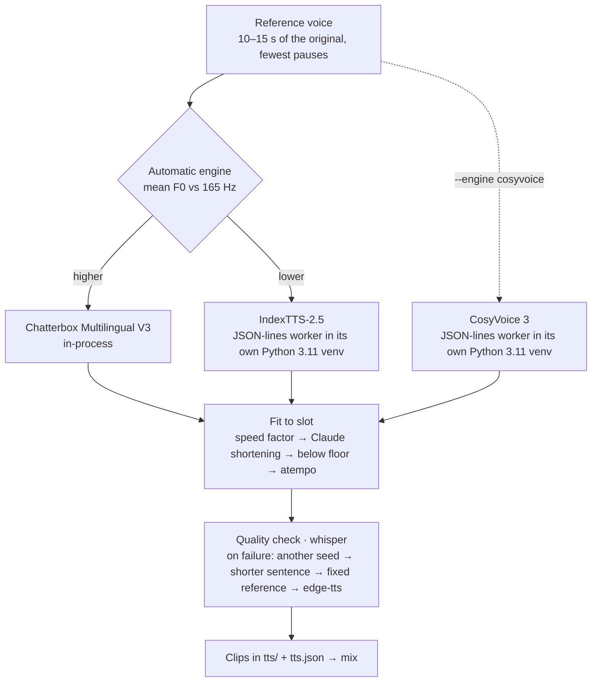

# Architecture

How the pieces fit together to dub a video. Each box links to the module that
implements it under `src/opendub/`.

## Pipeline

Green runs on the local GPU; orange talks to an external service (YouTube,
Claude).

| Piece | Module | Role |
|---|---|---|
| CLI | `cli.py` | `dub`, `web`, `setup-indextts` commands and their flags. |
| Web | `web/app.py`, `web/jobs.py`, `web/videos.py`, `frontend/` | Job queue (one at a time), replayable SSE progress, versions with their own numbers and issues, translation editor, Ctrl+C guard. The page is a React 19 + TypeScript app (`frontend/`) built into `web/static/`. |
| Pipeline | `pipeline.py` | Runs the phases in order; `release_models()` frees GPU memory after each web job. |
| Child processes | `media.py`, `engines.py` | The single place ffmpeg, yt-dlp's children, the engine workers (IndexTTS, CosyVoice) and the `claude` CLI are started from, so the web server can keep them out of a stray Ctrl+C and stop them on exit. `engines.py` is the shared JSON-lines client of the engines that run in their own venv. |
| Download | `download.py` | yt-dlp for the video, audio and thumbnail. |
| Transcription | `transcribe.py`, `segments.py` | Uses YouTube's subtitles when available, faster-whisper otherwise; regroups pieces into sentences with timings. |
| Separation | `separate.py` | HTDemucs splits the original voice from the background, which is kept for the mix. |
| Translation | `translate.py` | Claude translates each sentence within a character budget set by the voice's pace model; keeps hand edits made in the web. |
| Voice | `tts.py`, `clone.py`, `indextts.py`, `cosyvoice.py`, `reference.py`, `spoken.py` | See below. |
| Mix | `mix.py` | Places each clip at its timestamp over the background, writes `output.mp4` and archives a copy per engine in `outputs/`. |

Every phase stores its result in `work/<video id>/` under a hash of its
parameters in `manifest.json`: changing a setting reruns only from the phase it
affects (editing the translation in the web reruns from the voice).

## Voice phase

The slowest phase (about 86% of a dub's time).

- **Reference** (`reference.py`): the cleanest 10–15 s stretch of the separated
  voice; its mean F0 picks the engine under `--engine auto`.
- **Pace model** (`tts.py`): seconds = overhead + characters / characters per
  second, calibrated per voice and cached. It sets the translation's character
  budget and predicts each clip's speed factor.
- **Fit to slot**: IndexTTS and CosyVoice take a speed factor between 0.7 and 1.0 (one
  measured correction); if the clip still overflows, Claude shortens the
  sentence; then the factor may go down to 0.5 (logged in `overflow.log`), and
  `atempo` covers what is left.
- **Quality check** (`clone.py`): whisper transcribes each clip, with figures
  spelled out in words (`spoken.py`), and compares it with the text; failing
  clips walk the fallback chain, ending with edge-tts (Microsoft's online
  voice).
